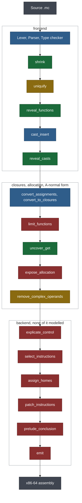
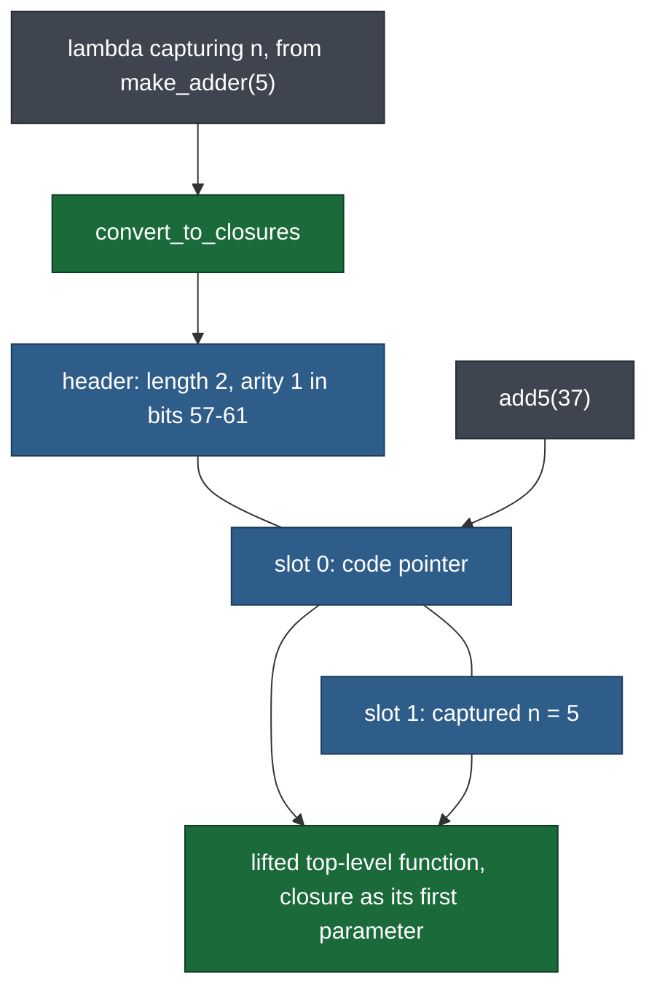
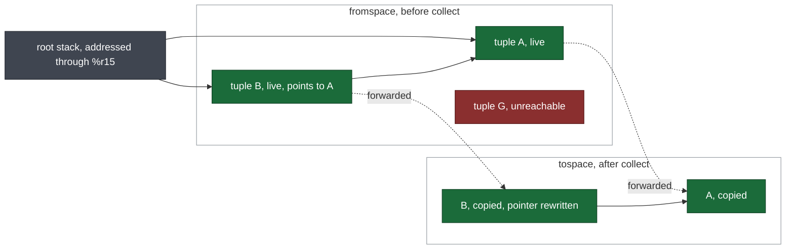
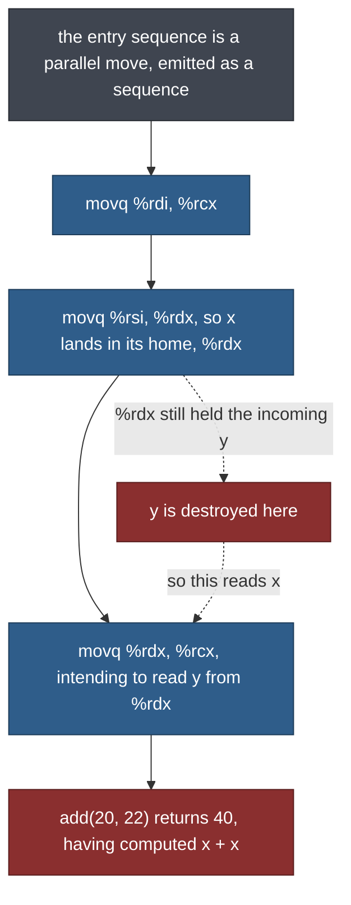

*A C++17 compiler from a small ML-flavoured language to x86-64 assembly, built to answer one question: what does formal verification buy a compiler, and where does it buy it?*

---

Twenty passes, 12,802 lines of C++17, graph-colouring register allocation, a Cheney copying collector, closures, dynamic typing. Built alongside five correctness regimes — Lean 4 proofs, Z3 properties, unit tests, a differential harness, Hoare-style contracts — to see which region of the compiler each one can actually cover.

---

## 1. Why verify a compiler

A compiler is the rare program whose interesting properties are *universal*. "This program compiles correctly" is about one input; "no `and` survives the `shrink` pass" is about every program anyone will ever write. Tests sample; proofs quantify. That gap is the case for verification, and it shows up as five regimes making five different kinds of claim:

| Regime | Kind of claim it makes | Region it covers |
|---|---|---|
| **Lean 4** — 36 theorems | universal, over every AST the model admits | structure of each frontend pass |
| **Z3** — 33 SMT properties | universal, over every bit pattern | tagging, ABI, graph and liveness facts |
| **Tests** — 316 cases | existential, one example at a time | transcription errors |
| **Differential harness** | value equality, per program | *does the binary compute the same answer?* |
| **Hoare contracts** | forces a property to be stated before it can be checked | preconditions of every pass |

None is redundant, and the useful question is never which one wins. Verification's most transferable contribution here sits upstream of any proof: **claims stop being decorative**. Twenty of thirty-five theorems in this repository once asserted literally nothing while the build stayed green. That is now mechanically impossible — §5.3.

---

## 2. See it run

```bash
cmake -B build -DCMAKE_BUILD_TYPE=Debug && cmake --build build

cat > adder.mc <<'EOF'
fn make_adder(n) { lambda (m) { m + n } }
let add5 = make_adder(5);
add5(37)
EOF

./build/src/mc --dyn adder.mc -o adder.s
gcc -o adder adder.s build/src/libmc_runtime.a -lm
./adder; echo $?                            # 42 — the value is the exit status

./build/src/mc --dyn -i adder.mc            # or interpret it, same answer
```

Three lines exercise most of the machine: `make_adder` returns a closure, so `n` is captured into a heap tuple the collector must trace; without annotations every value carries a 3-bit tag; `add5(37)` is an indirect call through a code pointer read out of that tuple.

The last command matters. For statically-typed programs the interpreter and the compiled binary share only the lexer, parser and type checker, so agreement is evidence and disagreement localises a fault. `tests/run_differential.sh` requires it across all 50 programs.

---

## 3. The machine

The language grows in eight phases, following Siek's *Essentials of Compilation* (2023) chapter by chapter, reimplemented from Racket in C++. Later sections refer to these phase numbers:

| Phase | Language | What it added |
|---|---|---|
| 1 | L_Var | integers, `let`, `read()`, arithmetic; lexer, parser, interpreter |
| 2 | — | liveness, interference graph, DSATUR colouring, move biasing |
| 3 | L_If | booleans, `if`, comparisons, `and`/`or`; the type checker; `shrink` |
| 4 | L_While | `while`, `set!`, mutable variables; worklist liveness over a cyclic CFG |
| 5 | L_Tup | heap tuples, the Cheney copying collector, root stack through `%r15` |
| 6 | L_Fun | top-level functions, System V ABI, tail calls |
| 7 | L_Lambda | lambdas, closure conversion, assignment conversion |
| 8 | L_Dyn / L_Any | dynamic typing behind `--dyn`, 3-bit runtime tags, `cast_insert` |

Twenty passes carry a program from source to assembly, coloured here by what Lean proves about each:



Green is proved by structural induction; gold is stated but left on a tracked `sorry`, Lean's placeholder for a proof not yet written; blue is partly modelled; red is not modelled. The backend is uniformly red, and every live bug in §7 was found there.

Every pass takes an AST or IR by const reference and returns a new one, so each is independently testable and every intermediate program printable. Read the numbers against a deliberately small language — integers, booleans, void, tuples, functions, no optimiser beyond move coalescing: 12,802 lines of C++17 over 20 passes, a 164-line C runtime, 316 tests, 33 Z3 properties, 36 Lean theorems in 1,776 lines, and 50 end-to-end programs run through both execution paths.

### 3.1 Register allocation

DSATUR colouring (`src/passes/graph_coloring.cpp`), move biasing tried before the greedy choice so a `movq` whose ends share a colour can be deleted. Liveness is a Kildall worklist fixpoint re-enqueuing *predecessors* on change (`src/passes/liveness.cpp`), because `while` makes the CFG cyclic.

### 3.2 Closures

A lambda becomes a heap tuple of its free variables plus a code pointer, its body lifted to a top-level function taking that tuple as an extra first parameter. Variables both assigned *and* captured are boxed first, so mutation is shared rather than copied.



### 3.3 The collector

A Cheney two-space copier. Tuple- and dynamically-typed (`Any`) variables cannot spill to the ordinary stack — the collector would not find them — so they spill to a *root stack* through `%r15`. Live objects are copied to tospace and a forwarding address overwrites the original's header; anything unreached is left behind when the spaces swap.



Every heap object carries a 64-bit header: bit 0 the forwarding flag, bits 1–6 the length, bits 7+ a pointer mask saying which slots to trace; closures add arity in bits 57–61. That layout is a design decision a solver had to bless — §5.2.

### 3.4 Dynamic typing

Under `--dyn` an unannotated value has static type `Any`, and phase 8 adds ten `L_Any` AST nodes to inject values into it and project them back out. At runtime the low three bits of every value are a tag: `001` int, `010` tuple, `011` procedure, `100` bool, `101` void. `000` is deliberately unused, so the collector can tell a tagged value from a plain 8-byte-aligned pointer — at the cost of 61-bit dynamic integers. The program's final value must be an `Int`, since it becomes the exit status; anything else is a trapped error.

---

## 4. Architecture as a correctness decision

Three choices in the C++ are there for the same reason the proofs are: each turns a class of bug into something the language or the build rules out.

### 4.1 No pass may recurse

Every AST-rewriting pass is a defunctionalised stack machine over an explicit frame variant, driven by a `while` loop. This costs real verbosity across nine passes and buys a property most teaching compilers lack: **the compiler cannot overflow its stack on a deeply nested program**, whatever the input. Termination is argued in the source too — 176 `// decreases` and `// invariant` annotations across 29 files.

### 4.2 One traversal, not nine copies of one

The phase-8 `L_Any` nodes are the easy ones to forget: ten of them, all carrying sub-expressions, all needing identical recursion in every rewriting pass. `src/passes/any_rebuild.h` defines that recursion once and each pass opens with a single call into it, so adding a node kind is a one-file change behind a switch the compiler checks. The bug class is not fixed nine times; it is made unrepresentable — the same move as the hygiene gate in §5.3, applied to C++ instead of Lean.

### 4.3 Conservatism where it is cheaper than cleverness

An `Any`-typed variable live across a call gets an interference edge to *every* allocable register, forcing it onto the root stack, because it may hold a pointer the collector must trace. A tail-call target is stashed in `%rax` before the epilogue runs, because it may live in a callee-saved register the epilogue is about to pop. Both trade an optimisation for a property that fits in one line.

---

## 5. What verification bought

### 5.1 Specification pressure

The highest-yield moment of the project involved no proof. It was writing the *proposition*.

The Lean model of `shrink` ended in a catch-all `| e => e`, commented as passing the phase-8 `L_Any` nodes through unchanged. They do not pass through: `inject`, `project`, `anyVectorRef` and seven other cast nodes carry sub-expressions. The moment the real statement was written — *every* `and`/`or` is eliminated — the proof refused to go through, correctly, because the proposition was false. Seven analyses shared the defect, and the model of `reveal_casts` did not recurse anywhere.

The defects were in the model, not the shipped C++ — but the class is real: skipped cases hiding behind a catch-all that reads as idiomatic completeness. §7.3 is that exact class, in a pass nobody modelled, compiled into a release binary.

The fixed theorem:

```lean4
theorem shrink_no_and_or (e : Expr) : noAndOr (shrink e) = true := by
  induction e using Expr.rec
    (motive_2 := fun es => noAndOrL (es.map shrink) = true) with
  | binary op l r ihl ihr => cases op <;> simp [shrink, noAndOr, ihl, ihr]
  | nil => simp [noAndOrL]
  | cons e es ih ihs => simp [noAndOrL, ih, ihs]
  | _ => simp_all [shrink, noAndOr]
```

A theorem of the form `p (f x) = true` is worthless if `p` is constantly true, and the statement alone cannot rule that out. So a witness is checked in beside it and elaborated by every build:

```lean4
theorem noAndOr_is_falsifiable :
    noAndOr (.inject (.binary .or_ (.bool true) (.bool false)) .bool) = false := by
  decide
```

Before the fix, `shrink` left that witness untouched. **Specification is where the value is; the proof is the enforcement mechanism.** A prover's real contribution is refusing to let a vague statement through.

### 5.2 One bit, all 2⁶⁴ headers

Some properties are about *all* bit patterns, and a test can only sample. The tag encodings are that shape, so they go to the solver over 64-bit bit-vectors — assert the negation, and UNSAT proves the property:

```cpp
/// @brief Scalars survive the tag round-trip over the representable range
/// ∀ v ∈ [-2^60, 2^60): ((v << 3) | 001) >>arith 3 == v
TEST(TaggingZ3, ScalarTagRoundTrip) {
    Ctx c;
    Z3_ast v = c.var("v");
    c.assert_ast(Z3_mk_bvsle(c.ctx, c.bv(-(1LL << 60)), v));
    c.assert_ast(Z3_mk_bvslt(c.ctx, v, c.bv(1LL << 60)));

    Z3_ast tagged = Z3_mk_bvor(c.ctx,
        Z3_mk_bvshl(c.ctx, v, c.bv(kTagShift)), c.bv(kTagInt));
    Z3_ast back = Z3_mk_bvashr(c.ctx, tagged, c.bv(kTagShift));
    c.assert_ast(Z3_mk_not(c.ctx, Z3_mk_eq(c.ctx, back, v)));
    EXPECT_TRUE(c.unsat());
}
```

One of the thirty-three justifies a design decision rather than confirming one: the object length starts at bit 1 because bit 0 is the forwarding flag. Had it started at bit 0, **every live object of odd length would read as already-forwarded**, and the collector would follow its length field as an address — silent heap corruption, unreachable by fuzzing, invisible to AddressSanitizer because the writes come from generated assembly. A one-bit constraint over all 2⁶⁴ headers, which no sampling test can even state.

### 5.3 Verifying the verification

A green `lake build` says every proof elaborates. It does not say the proofs are worth anything. An audit found twenty of the then-thirty-five theorems in this shape:

```lean4
/-- Closure conversion preserves evaluation semantics. -/
theorem closure_conversion_preserves_semantics : ∀ _p : Program, True := by
  intro _; trivial
```

Valid Lean. Green build. Roadmap ticked. Two were worse for looking real — one concluded `… ∨ True`, another `tagof t = tagof t`, reflexivity wearing the name of a round-trip property. They survive review because **every signal a reviewer uses is intact**: right file, a name that reads as a real claim, correct docstring, a short proof that reads elegant rather than empty. The only wrong thing is the proposition between the colon and the `:=` — the one place a reader's eye skips.

This is not a Lean quirk; the same shape appears as a test asserting `expect(x).toBeDefined()`, or an alert on a metric nobody emits. So the fix was not "fix the theorems" (one commit) but `lean/Hygiene.lean` (a build gate, permanent). It fails the build on a vacuous conclusion, a `sorry` outside a checked-in allowlist, or a dependency on `Lean.ofReduceBool` — `native_decide`, which closes goals the kernel cannot check.

```lean4
/-- A conclusion with no content: `True`, a disjunction with a `True` side, or
    a reflexive equation. -/
def vacuousBody (b : Lean.Expr) : Bool :=
  b.isConstOf ``True
  || (b.isAppOfArity ``Or 2 && (hasTrue b.appFn!.appArg! || hasTrue b.appArg!))
  || (b.isAppOfArity ``Eq 3 && b.appFn!.appArg! == b.appArg!)
```

Two design points earned by running it. The allowlist holds **names, not a count**, so a `sorry` fixed in one place and reintroduced in another cannot hide behind an unchanged total. And it filters by **module, not namespace** — three pass files declare theorems at the root, so a `MiniCompiler.`-prefix test silently skipped twelve of them, the exact blind spot the checker exists to prevent.

The gate then found a second thing in the same family: one pass module **had not compiled since phase 8 landed**, because the lakefile had no `globs` and nothing imported it. Fixed structurally with ``globs := #[.andSubmodules `MiniCompiler]`` plus a pre-commit check that the root imports every module. A green check mark is a claim about whatever was actually checked, and that set is itself worth checking.

The gate is a floor, not a quality bar: it catches vacuity in `Or` and `Eq` only, and cannot tell that a statement is *false* of the model.

### 5.4 A ranking of weak theorems

Not every weak theorem can be repaired by writing the statement. `limit_functions` packs the parameters of over-arity functions into a tuple in 371 lines of C++, but the Lean model is `fun p => p` — so the natural statement, `∀ d ∈ (limit_functions p).defs, d.params.length ≤ 6`, is **false** of the model. A `sorry` there would leave the repository formally asserting something untrue, and anyone later discharging it would have derived `False`. Hence a ranking:

1. Real statement, real proof.
2. Real, *true* statement with a tracked `sorry` — declared debt.
3. Vacuous statement — proves nothing, harms nothing except your credibility.
4. **False statement with a `sorry`** — actively poisonous.

Two theorems sat at (4) as their only defensible option and were deleted, each with the reason recorded beside the model it was false of.

---

## 6. What is proved, and what is not

### 6.1 The proof table

Every claim in this article should be read against this table.

| Property | Status |
|---|---|
| `shrink` eliminates every `and`/`or` | **proved** — structural induction |
| `reveal_casts` leaves no `inject`/`project`/predicate | **proved** — structural induction |
| `reveal_functions` leaves no `var` naming a function | **proved** — structural induction |
| `uncover_get` leaves no `var` naming a mutable variable | **proved** — structural induction |
| Free variables are captured; a variable is boxed iff assigned *and* captured; parameters bind | **proved**, definitional |
| Runtime tags separate the five shapes, and none is `000` | **proved** by `decide` over five literals |
| Single-instruction liveness transfer; colouring *specification* | **proved** — see below |
| A-normal form after `remove_complex_operands`; no shadowing after `uniquify` | *stated, tracked `sorry`* |
| **Semantics preservation, for any pass** | **not modelled** |
| **The entire backend** (explicate, select, assign homes, patch, prelude) | **not modelled** |

Two caveats keep the table narrow. The dataflow row is the weakest: nothing is proved about the liveness *fixpoint*, only the single-instruction transfer function, and the colouring module holds a *specification* of a valid colouring — symmetric, irreflexive, respected — not a proof of DSATUR. And these are properties of a hand-written Lean model, not of the C++; nothing checks that the two agree, so the proofs catch design errors while the tests and the differential harness catch transcription errors.

### 6.2 The next tier: semantics preservation

The expensive tier demonstrably pays. Yang et al. (PLDI 2011) threw a random program generator at every C compiler they could find, reported hundreds of bugs in GCC and LLVM, and found none in CompCert's middle end — verified for *semantics preservation*, not syntax. That is the target, and it is worth pricing exactly.

`shrink_preserves_semantics` cannot even be *stated* without an operational semantics, and the signature people reach for, `eval : Env → Expr → Option Value`, is insufficient four times over:

- assignment (`set!`) and tuple writes (`vectorSet`) mutate, so it needs a store;
- `read` is I/O, so it needs an input stream;
- `while` and general application need not terminate, so Lean demands a fuel parameter;
- a trapped dynamic type error is a third outcome, distinct from both "value" and "stuck".

Roughly 400 lines before a single theorem, plus a fuel-monotonicity lemma every later proof depends on, and each preservation theorem is days to weeks on its own. Verification cost is superlinear in language features: the syntactic tier is the one an eight-phase compiler can afford end to end, and the semantic tier is the deliberate next step rather than an abandoned one.

---

## 7. Where the model stopped, bugs lived

The pipeline in §3 is red from `explicate_control` onward. Every live defect below sits in that red region, or in a pass the model never described — an argument for extending the model, not for doubting it.

### 7.1 add(20, 22) == 40

`fn add(x: Int, y: Int) : Int { x + y }` returned 40, and had since phase 6, through two later language phases and a then-287-case suite. The System V ABI passes arguments in `%rdi, %rsi, %rdx, …`, and a function's entry sequence is a **parallel move** emitted as a sequence:



Root cause: liveness tracks *variables*, and physical registers are invisible to it, so the interference graph had no edge and the allocator was free to home `x` in a register still holding `y`. The fix precolours parameter `i` against every argument register still holding a later parameter (`src/passes/assign_homes.cpp:173-182`). The caller side has no such hazard, for a checkable reason: an indirect call clobbers all caller-saved registers, so anything live across it already interferes with every argument register.

Why did 287 tests miss it? They asserted *structure* — a `callq` emitted, a tail call becoming `jmp` — and single-argument functions cannot exhibit the bug. `tests/run_differential.sh` found it on its first run, asking the one question structural assertions cannot: does the binary compute the same value? The regression test now asserts the invariant rather than an example — no instruction in the entry mov run may read a register an earlier one wrote — verified by disabling the fix and watching it fail. A regression test never observed failing is itself an unfalsifiable claim.

### 7.2 The allocator that checked for room too late

The phase-5 collector shipped with no direct tests. Writing them found the collector fine and its *caller* wrong: `expose_allocation` emitted the heap-exhaustion check *after* bumping `free_ptr`. An object could land past `fromspace_end`, and if the check did fire, `collect` ran before the fresh object was rooted — it was not copied, and `free_ptr` was reset back over it.

It never manifested: allocator slack absorbed the overflow, shrinking the heap to 48 bytes still produced right answers, and AddressSanitizer cannot see writes from generated assembly. A latent memory-corruption bug testing could not provoke, found because writing a test for a *stated property* forced the question of whether the property held (`src/passes/expose_allocation.cpp:179-182`).

### 7.3 The catch-all that was real

The bug class §5.1 exposed in the model does occur in the C++ — in a pass nobody modelled. `make_atom` in `explicate_control` ended in `default: return expr_cast<VarExpr>(e)`, reinterpreting *any* node kind as a `VarExpr`: an assert in a debug build, undefined behaviour in a release one. It was reached by `read() + 10`. The repair was in `remove_complex_operands` (`src/passes/rco.cpp`), which now let-binds `Read` instead of taking a shortcut, so `make_atom` never sees it.

The model was right about the shape of the danger and looking in the wrong language. Across these three defects no regime dominates: proofs cover structure, the solver covers bit patterns, contracts force properties into words, the harness covers values — each in its own region, and the regions are the point.

---

## 8. Limits and next steps

- **Nothing links the Lean model to the C++.** The standard closures — translation validation, extraction, or simply running model and pass over the same ASTs and diffing — are all open here.
- **Contracts are documentation, not a checked regime.** Three-quarters of functions carry `@requires`/`@ensures`; no tool reads them.
- **The differential harness is weaker under `--dyn`.** Both paths deliberately share four frontend passes, so a fault inside those four cannot be localised by disagreement.

Next, in order of value: an operational semantics for the frontend, which unlocks the preservation theorems of §6.2; then discharging the three tracked `sorry`s.

---

## 9. Reference

Siek, J. G. (2023). *Essentials of Compilation: An Incremental Approach in Racket*. MIT Press. ISBN 9780262047760.

Yang, X., Chen, Y., Eide, E., & Regehr, J. (2011). Finding and understanding bugs in C compilers. *PLDI '11*.
