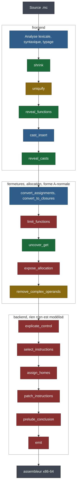
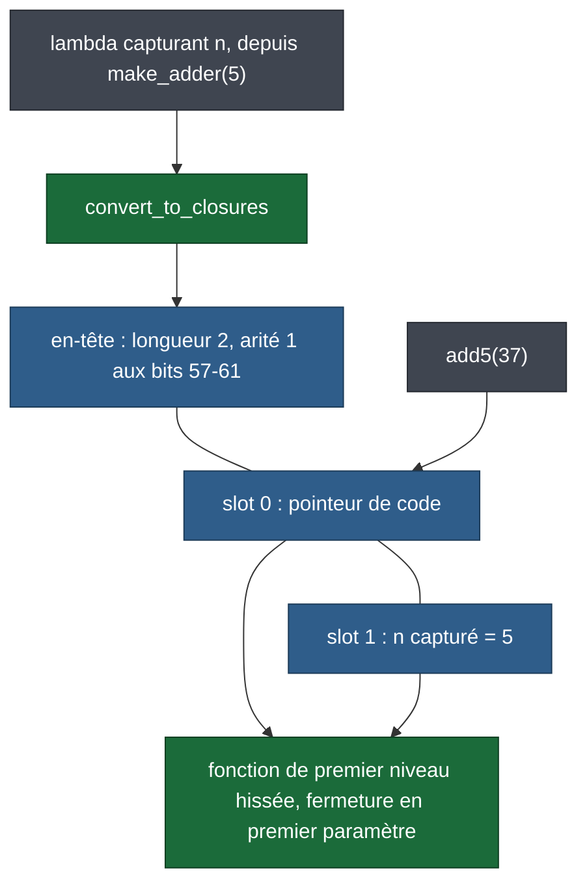
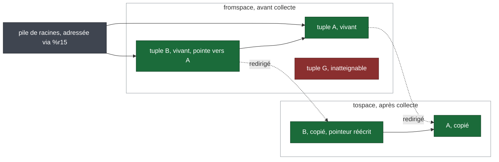
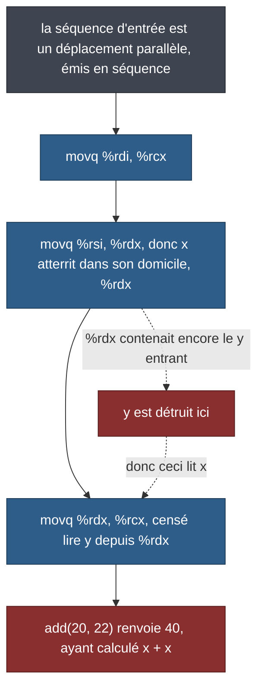

*Un compilateur C++17 d'un petit langage inspiré de ML vers l'assembleur x86-64, construit pour répondre à une question : qu'est-ce que la vérification formelle apporte à un compilateur, et où l'apporte-t-elle ?*

---

Vingt passes, 12 802 lignes de C++17, allocation de registres par coloration de graphe, un ramasse-miettes copiant de Cheney, des fermetures, du typage dynamique. Construit en parallèle de cinq régimes de correction — preuves Lean 4, propriétés Z3, tests unitaires, harnais différentiel, contrats à la Hoare — pour voir quelle région du compilateur chacun couvre réellement.

---

## 1. Pourquoi vérifier un compilateur

Un compilateur est ce programme rare dont les propriétés intéressantes sont *universelles*. « Ce programme se compile correctement » porte sur une seule entrée ; « aucun `and` ne survit à la passe `shrink` » porte sur tous les programmes que quiconque écrira jamais. Les tests échantillonnent ; les preuves quantifient. C'est cet écart qui justifie la vérification, et il se traduit par cinq régimes formulant cinq types d'affirmation différents :

| Régime | Type d'affirmation | Région couverte |
|---|---|---|
| **Lean 4** — 36 théorèmes | universelle, sur chaque AST que le modèle admet | la structure de chaque passe du frontend |
| **Z3** — 33 propriétés SMT | universelle, sur chaque motif de bits | étiquetage, ABI, faits de graphe et de vivacité |
| **Tests** — 316 cas | existentielle, un exemple à la fois | erreurs de transcription |
| **Harnais différentiel** | égalité de valeurs, programme par programme | *le binaire calcule-t-il la même réponse ?* |
| **Contrats de Hoare** | force l'énoncé d'une propriété avant de pouvoir la vérifier | préconditions de chaque passe |

Aucun n'est redondant, et la question utile n'est jamais de savoir lequel l'emporte. La contribution la plus transposable de la vérification se situe ici en amont de toute preuve : **les affirmations cessent d'être décoratives**. Vingt des trente-cinq théorèmes de ce dépôt n'affirmaient autrefois littéralement rien alors que la compilation restait au vert. C'est désormais mécaniquement impossible — §5.3.

---

## 2. Le voir tourner

```bash
cmake -B build -DCMAKE_BUILD_TYPE=Debug && cmake --build build

cat > adder.mc <<'EOF'
fn make_adder(n) { lambda (m) { m + n } }
let add5 = make_adder(5);
add5(37)
EOF

./build/src/mc --dyn adder.mc -o adder.s
gcc -o adder adder.s build/src/libmc_runtime.a -lm
./adder; echo $?                            # 42 — la valeur est le code de sortie

./build/src/mc --dyn -i adder.mc            # ou l'interpréter, même réponse
```

Trois lignes sollicitent l'essentiel de la machine : `make_adder` renvoie une fermeture, donc `n` est capturé dans un tuple du tas que le ramasse-miettes doit tracer ; sans annotations, chaque valeur porte une étiquette de 3 bits ; `add5(37)` est un appel indirect via un pointeur de code lu depuis ce tuple.

La dernière commande est importante. Pour les programmes typés statiquement, l'interpréteur et le binaire compilé ne partagent que l'analyseur lexical, l'analyseur syntaxique et le vérificateur de types : l'accord est donc une preuve et le désaccord localise une faute. `tests/run_differential.sh` l'exige sur les 50 programmes.

---

## 3. La machine

Le langage grandit en huit phases, en suivant chapitre par chapitre *Essentials of Compilation* de Siek (2023), réimplémenté depuis Racket en C++. Les sections suivantes renvoient à ces numéros de phase :

| Phase | Langage | Ce qu'elle a ajouté |
|---|---|---|
| 1 | L_Var | entiers, `let`, `read()`, arithmétique ; analyseur lexical, analyseur syntaxique, interpréteur |
| 2 | — | vivacité, graphe d'interférence, coloration DSATUR, biais de déplacement |
| 3 | L_If | booléens, `if`, comparaisons, `and`/`or` ; le vérificateur de types ; `shrink` |
| 4 | L_While | `while`, `set!`, variables mutables ; vivacité par liste de travail sur un CFG cyclique |
| 5 | L_Tup | tuples sur le tas, le ramasse-miettes copiant de Cheney, pile de racines via `%r15` |
| 6 | L_Fun | fonctions de premier niveau, ABI System V, appels terminaux |
| 7 | L_Lambda | lambdas, conversion de fermetures, conversion d'affectations |
| 8 | L_Dyn / L_Any | typage dynamique derrière `--dyn`, étiquettes d'exécution de 3 bits, `cast_insert` |

Vingt passes portent un programme de la source à l'assembleur, colorées ici selon ce que Lean prouve de chacune :



Le vert est prouvé par induction structurelle ; l'or est énoncé mais laissé sur un `sorry` suivi, le marqueur de Lean pour une preuve pas encore écrite ; le bleu est partiellement modélisé ; le rouge n'est pas modélisé. Le backend est uniformément rouge, et c'est là que se trouvait chacun des bugs réels du §7.

Chaque passe prend un AST ou une IR par référence constante et en renvoie un nouveau : chacune est donc testable indépendamment et chaque programme intermédiaire est affichable. Il faut lire les chiffres à l'aune d'un langage délibérément petit — entiers, booléens, void, tuples, fonctions, aucun optimiseur au-delà de la fusion de déplacements : 12 802 lignes de C++17 sur 20 passes, un runtime C de 164 lignes, 316 tests, 33 propriétés Z3, 36 théorèmes Lean en 1 776 lignes, et 50 programmes de bout en bout exécutés par les deux chemins.

### 3.1 Allocation de registres

Coloration DSATUR (`src/passes/graph_coloring.cpp`), avec un biais de déplacement essayé avant le choix glouton, de sorte qu'un `movq` dont les deux extrémités partagent une couleur peut être supprimé. La vivacité est un point fixe par liste de travail de Kildall qui réenfile les *prédécesseurs* à chaque changement (`src/passes/liveness.cpp`), parce que `while` rend le CFG cyclique.

### 3.2 Fermetures

Une lambda devient un tuple sur le tas contenant ses variables libres plus un pointeur de code, son corps étant hissé en une fonction de premier niveau prenant ce tuple comme premier paramètre supplémentaire. Les variables à la fois affectées *et* capturées sont d'abord mises en boîte, pour que la mutation soit partagée plutôt que copiée.



### 3.3 Le ramasse-miettes

Un copieur à deux espaces de Cheney. Les variables de type tuple et celles typées dynamiquement (`Any`) ne peuvent pas déborder sur la pile ordinaire — le ramasse-miettes ne les y trouverait pas — elles débordent donc sur une *pile de racines* via `%r15`. Les objets vivants sont copiés vers le tospace et une adresse de redirection écrase l'en-tête de l'original ; tout ce qui n'est pas atteint est laissé sur place lors de l'échange des espaces.



Chaque objet du tas porte un en-tête de 64 bits : le bit 0 est le drapeau de redirection, les bits 1–6 la longueur, les bits 7+ un masque de pointeurs indiquant quels slots tracer ; les fermetures ajoutent l'arité aux bits 57–61. Cette disposition est une décision de conception qu'un solveur a dû avaliser — §5.2.

### 3.4 Typage dynamique

Sous `--dyn`, une valeur non annotée a pour type statique `Any`, et la phase 8 ajoute dix nœuds d'AST `L_Any` pour y injecter des valeurs et les en projeter de nouveau. À l'exécution, les trois bits de poids faible de chaque valeur forment une étiquette : `001` entier, `010` tuple, `011` procédure, `100` booléen, `101` void. `000` est délibérément inutilisé, afin que le ramasse-miettes puisse distinguer une valeur étiquetée d'un simple pointeur aligné sur 8 octets — au prix d'entiers dynamiques sur 61 bits. La valeur finale du programme doit être un `Int`, puisqu'elle devient le code de sortie ; toute autre chose est une erreur interceptée.

---

## 4. L'architecture comme décision de correction

Trois choix dans le C++ sont là pour la même raison que les preuves : chacun transforme une classe de bugs en quelque chose que le langage ou la compilation exclut.

### 4.1 Aucune passe ne peut être récursive

Chaque passe de réécriture d'AST est une machine à pile défonctionnalisée sur une variante de trame explicite, pilotée par une boucle `while`. Cela coûte une réelle verbosité sur neuf passes et achète une propriété que la plupart des compilateurs pédagogiques n'ont pas : **le compilateur ne peut pas déborder sa pile sur un programme profondément imbriqué**, quelle que soit l'entrée. La terminaison est également argumentée dans le code source — 176 annotations `// decreases` et `// invariant` réparties sur 29 fichiers.

### 4.2 Un seul parcours, pas neuf copies d'un même parcours

Les nœuds `L_Any` de la phase 8 sont ceux qu'on oublie facilement : ils sont dix, portent tous des sous-expressions, et exigent tous une récursion identique dans chaque passe de réécriture. `src/passes/any_rebuild.h` définit cette récursion une seule fois et chaque passe s'ouvre par un unique appel vers elle : ajouter une sorte de nœud est donc une modification d'un seul fichier, derrière un `switch` que le compilateur vérifie. La classe de bugs n'est pas corrigée neuf fois ; elle est rendue non représentable — le même geste que la barrière d'hygiène du §5.3, appliqué au C++ plutôt qu'à Lean.

### 4.3 Du conservatisme là où il coûte moins cher que l'astuce

Une variable de type `Any` vivante à travers un appel reçoit une arête d'interférence vers *chaque* registre allouable, ce qui la force sur la pile de racines, car elle peut contenir un pointeur que le ramasse-miettes doit tracer. La cible d'un appel terminal est mise de côté dans `%rax` avant l'exécution de l'épilogue, car elle peut résider dans un registre callee-saved que l'épilogue s'apprête à dépiler. Les deux échangent une optimisation contre une propriété qui tient en une ligne.

---

## 5. Ce que la vérification a apporté

### 5.1 La pression de spécification

Le moment le plus rentable du projet n'a impliqué aucune preuve. C'était l'écriture de la *proposition*.

Le modèle Lean de `shrink` se terminait par un cas fourre-tout `| e => e`, commenté comme laissant passer inchangés les nœuds `L_Any` de la phase 8. Ils ne passent pas : `inject`, `project`, `anyVectorRef` et sept autres nœuds de cast portent des sous-expressions. Dès que le véritable énoncé a été écrit — *chaque* `and`/`or` est éliminé — la preuve a refusé de passer, à juste titre, parce que la proposition était fausse. Sept analyses partageaient le défaut, et le modèle de `reveal_casts` ne récursait nulle part.

Les défauts étaient dans le modèle, pas dans le C++ livré — mais la classe est bien réelle : des cas omis se cachant derrière un fourre-tout qui se lit comme une complétude idiomatique. Le §7.3 est exactement cette classe, dans une passe que personne n'avait modélisée, compilée dans un binaire de release.

Le théorème corrigé :

```lean4
theorem shrink_no_and_or (e : Expr) : noAndOr (shrink e) = true := by
  induction e using Expr.rec
    (motive_2 := fun es => noAndOrL (es.map shrink) = true) with
  | binary op l r ihl ihr => cases op <;> simp [shrink, noAndOr, ihl, ihr]
  | nil => simp [noAndOrL]
  | cons e es ih ihs => simp [noAndOrL, ih, ihs]
  | _ => simp_all [shrink, noAndOr]
```

Un théorème de la forme `p (f x) = true` ne vaut rien si `p` est constamment vrai, et l'énoncé seul ne peut pas l'exclure. Un témoin est donc versé au dépôt à côté de lui et élaboré à chaque compilation :

```lean4
theorem noAndOr_is_falsifiable :
    noAndOr (.inject (.binary .or_ (.bool true) (.bool false)) .bool) = false := by
  decide
```

Avant la correction, `shrink` laissait ce témoin intact. **La valeur est dans la spécification ; la preuve est le mécanisme d'application.** La véritable contribution d'un assistant de preuve est de refuser de laisser passer un énoncé vague.

### 5.2 Un bit, les 2⁶⁴ en-têtes

Certaines propriétés portent sur *tous* les motifs de bits, et un test ne peut qu'échantillonner. Les encodages d'étiquettes ont cette forme : ils passent donc au solveur sur des vecteurs de 64 bits — on affirme la négation, et UNSAT prouve la propriété :

```cpp
/// @brief Scalars survive the tag round-trip over the representable range
/// ∀ v ∈ [-2^60, 2^60): ((v << 3) | 001) >>arith 3 == v
TEST(TaggingZ3, ScalarTagRoundTrip) {
    Ctx c;
    Z3_ast v = c.var("v");
    c.assert_ast(Z3_mk_bvsle(c.ctx, c.bv(-(1LL << 60)), v));
    c.assert_ast(Z3_mk_bvslt(c.ctx, v, c.bv(1LL << 60)));

    Z3_ast tagged = Z3_mk_bvor(c.ctx,
        Z3_mk_bvshl(c.ctx, v, c.bv(kTagShift)), c.bv(kTagInt));
    Z3_ast back = Z3_mk_bvashr(c.ctx, tagged, c.bv(kTagShift));
    c.assert_ast(Z3_mk_not(c.ctx, Z3_mk_eq(c.ctx, back, v)));
    EXPECT_TRUE(c.unsat());
}
```

L'une des trente-trois justifie une décision de conception plutôt que d'en confirmer une : la longueur de l'objet commence au bit 1 parce que le bit 0 est le drapeau de redirection. Si elle avait commencé au bit 0, **chaque objet vivant de longueur impaire serait lu comme déjà redirigé**, et le ramasse-miettes suivrait son champ de longueur comme une adresse — corruption silencieuse du tas, hors d'atteinte du fuzzing, invisible pour AddressSanitizer parce que les écritures proviennent de l'assembleur généré. Une contrainte d'un seul bit sur les 2⁶⁴ en-têtes, qu'aucun test par échantillonnage ne peut même énoncer.

### 5.3 Vérifier la vérification

Un `lake build` au vert dit que chaque preuve s'élabore. Il ne dit pas que les preuves valent quelque chose. Un audit a trouvé que vingt des trente-cinq théorèmes d'alors étaient de cette forme :

```lean4
/-- Closure conversion preserves evaluation semantics. -/
theorem closure_conversion_preserves_semantics : ∀ _p : Program, True := by
  intro _; trivial
```

Du Lean valide. Compilation au vert. Feuille de route cochée. Deux étaient pires parce qu'ils avaient l'air réels — l'un concluait `… ∨ True`, l'autre `tagof t = tagof t`, de la réflexivité portant le nom d'une propriété d'aller-retour. Ils survivent à la relecture parce que **chaque signal qu'utilise un relecteur est intact** : le bon fichier, un nom qui se lit comme une vraie affirmation, une docstring correcte, une preuve courte qui se lit comme élégante plutôt que vide. La seule chose fausse est la proposition entre les deux-points et le `:=` — le seul endroit que l'œil du lecteur survole.

Ce n'est pas une bizarrerie de Lean ; la même forme apparaît sous les traits d'un test affirmant `expect(x).toBeDefined()`, ou d'une alerte sur une métrique que personne n'émet. Le correctif n'a donc pas été « corriger les théorèmes » (un commit) mais `lean/Hygiene.lean` (une barrière de compilation, permanente). Elle fait échouer la compilation en cas de conclusion vide, de `sorry` hors d'une liste blanche versée au dépôt, ou de dépendance à `Lean.ofReduceBool` — `native_decide`, qui ferme des buts que le noyau ne peut pas vérifier.

```lean4
/-- A conclusion with no content: `True`, a disjunction with a `True` side, or
    a reflexive equation. -/
def vacuousBody (b : Lean.Expr) : Bool :=
  b.isConstOf ``True
  || (b.isAppOfArity ``Or 2 && (hasTrue b.appFn!.appArg! || hasTrue b.appArg!))
  || (b.isAppOfArity ``Eq 3 && b.appFn!.appArg! == b.appArg!)
```

Deux points de conception gagnés en l'exécutant pour de vrai. La liste blanche contient des **noms, pas un compteur** : un `sorry` corrigé à un endroit et réintroduit ailleurs ne peut donc pas se cacher derrière un total inchangé. Et elle filtre par **module, pas par espace de noms** — trois fichiers de passes déclarent des théorèmes à la racine, si bien qu'un test sur le préfixe `MiniCompiler.` en sautait silencieusement douze, précisément l'angle mort que ce vérificateur existe pour empêcher.

La barrière a ensuite trouvé une seconde chose de la même famille : un module de passe **ne compilait plus depuis l'arrivée de la phase 8**, parce que le lakefile n'avait pas de `globs` et que rien ne l'importait. Corrigé structurellement avec ``globs := #[.andSubmodules `MiniCompiler]`` plus une vérification de pre-commit que la racine importe chaque module. Une coche verte est une affirmation portant sur ce qui a été effectivement vérifié, et cet ensemble mérite lui-même d'être vérifié.

La barrière est un plancher, pas un critère de qualité : elle n'attrape la vacuité que dans `Or` et `Eq`, et ne peut pas dire qu'un énoncé est *faux* pour le modèle.

### 5.4 Un classement des théorèmes faibles

Tout théorème faible ne peut pas être réparé en écrivant l'énoncé. `limit_functions` empaquette dans un tuple les paramètres des fonctions de trop grande arité, en 371 lignes de C++, mais le modèle Lean est `fun p => p` — l'énoncé naturel, `∀ d ∈ (limit_functions p).defs, d.params.length ≤ 6`, est donc **faux** pour le modèle. Un `sorry` à cet endroit laisserait le dépôt affirmer formellement quelque chose de faux, et quiconque le déchargerait plus tard aurait dérivé `False`. D'où un classement :

1. Énoncé réel, preuve réelle.
2. Énoncé réel et *vrai* avec un `sorry` suivi — une dette déclarée.
3. Énoncé vide — ne prouve rien, ne nuit à rien sinon à votre crédibilité.
4. **Énoncé faux avec un `sorry`** — activement toxique.

Deux théorèmes se trouvaient en (4) comme seule option défendable et ont été supprimés, chacun avec la raison consignée à côté du modèle pour lequel il était faux.

---

## 6. Ce qui est prouvé et ce qui ne l'est pas

### 6.1 Le tableau des preuves

Chaque affirmation de cet article doit être lue à la lumière de ce tableau.

| Propriété | Statut |
|---|---|
| `shrink` élimine chaque `and`/`or` | **prouvé** — induction structurelle |
| `reveal_casts` ne laisse aucun `inject`/`project`/prédicat | **prouvé** — induction structurelle |
| `reveal_functions` ne laisse aucun `var` nommant une fonction | **prouvé** — induction structurelle |
| `uncover_get` ne laisse aucun `var` nommant une variable mutable | **prouvé** — induction structurelle |
| Les variables libres sont capturées ; une variable est mise en boîte ssi affectée *et* capturée ; les paramètres lient | **prouvé**, définitionnel |
| Les étiquettes d'exécution séparent les cinq formes, et aucune n'est `000` | **prouvé** par `decide` sur cinq littéraux |
| Transfert de vivacité mono-instruction ; *spécification* de coloration | **prouvé** — voir ci-dessous |
| Forme A-normale après `remove_complex_operands` ; pas de masquage après `uniquify` | *énoncé, `sorry` suivi* |
| **Préservation de la sémantique, pour toute passe** | **non modélisé** |
| **Tout le backend** (explicate, select, assign homes, patch, prelude) | **non modélisé** |

Deux réserves restreignent ce tableau. La ligne du flot de données est la plus faible : rien n'est prouvé sur le *point fixe* de vivacité, seulement sur la fonction de transfert mono-instruction, et le module de coloration contient une *spécification* de coloration valide — symétrique, irréflexive, respectée — pas une preuve de DSATUR. Et ce sont des propriétés d'un modèle Lean écrit à la main, pas du C++ ; rien ne vérifie que les deux concordent, si bien que les preuves attrapent des erreurs de conception tandis que les tests et le harnais différentiel attrapent les erreurs de transcription.

### 6.2 Le niveau supérieur : la préservation de la sémantique

Le niveau coûteux paie manifestement. Yang et al. (PLDI 2011) ont lancé un générateur aléatoire de programmes sur tous les compilateurs C qu'ils ont pu trouver, ont signalé des centaines de bugs dans GCC et LLVM, et n'en ont trouvé aucun dans le middle end de CompCert — vérifié pour la *préservation de la sémantique*, pas pour la syntaxe. C'est la cible, et elle mérite d'être chiffrée précisément.

`shrink_preserves_semantics` ne peut même pas être *énoncé* sans une sémantique opérationnelle, et la signature vers laquelle on se tourne spontanément, `eval : Env → Expr → Option Value`, est insuffisante à quatre titres :

- l'affectation (`set!`) et l'écriture dans un tuple (`vectorSet`) mutent, il faut donc un store ;
- `read` fait des entrées-sorties, il faut donc un flux d'entrée ;
- `while` et l'application générale peuvent ne pas terminer, Lean exige donc un paramètre de carburant ;
- une erreur de type dynamique interceptée est une troisième issue, distincte à la fois de « valeur » et de « bloqué ».

Environ 400 lignes avant le moindre théorème, plus un lemme de monotonie du carburant dont dépend chaque preuve ultérieure, et chaque théorème de préservation représente des jours voire des semaines à lui seul. Le coût de la vérification est superlinéaire en nombre de fonctionnalités du langage : le niveau syntaxique est celui qu'un compilateur de huit phases peut s'offrir de bout en bout, et le niveau sémantique est l'étape suivante délibérée plutôt qu'une étape abandonnée.

---

## 7. Là où le modèle s'arrête, les bugs prospèrent

Le pipeline du §3 est rouge à partir d'`explicate_control`. Chaque défaut réel ci-dessous se situe dans cette région rouge, ou dans une passe que le modèle n'a jamais décrite — un argument pour étendre le modèle, pas pour en douter.

### 7.1 add(20, 22) == 40

`fn add(x: Int, y: Int) : Int { x + y }` renvoyait 40, et ce depuis la phase 6, à travers deux phases de langage ultérieures et une suite de 287 cas d'alors. L'ABI System V passe les arguments dans `%rdi, %rsi, %rdx, …`, et la séquence d'entrée d'une fonction est un **déplacement parallèle** émis sous forme de séquence :



Cause racine : la vivacité suit les *variables*, et les registres physiques lui sont invisibles ; le graphe d'interférence n'avait donc pas d'arête et l'allocateur était libre de domicilier `x` dans un registre contenant encore `y`. Le correctif précolore le paramètre `i` contre chaque registre d'argument contenant encore un paramètre ultérieur (`src/passes/assign_homes.cpp:173-182`). Le côté appelant n'a pas ce danger, pour une raison vérifiable : un appel indirect écrase tous les registres caller-saved, donc tout ce qui est vivant à travers lui interfère déjà avec chaque registre d'argument.

Pourquoi 287 tests l'ont-ils manqué ? Ils vérifiaient la *structure* — un `callq` émis, un appel terminal devenant `jmp` — et les fonctions à un seul argument ne peuvent pas exhiber le bug. `tests/run_differential.sh` l'a trouvé dès sa première exécution, en posant la seule question que les assertions structurelles ne peuvent pas poser : le binaire calcule-t-il la même valeur ? Le test de régression vérifie désormais l'invariant plutôt qu'un exemple — aucune instruction de la séquence de `mov` d'entrée ne peut lire un registre écrit par une instruction antérieure — validé en désactivant le correctif et en le regardant échouer. Un test de régression qu'on n'a jamais vu échouer est lui-même une affirmation infalsifiable.

### 7.2 L'allocateur qui vérifiait la place trop tard

Le ramasse-miettes de la phase 5 a été livré sans test direct. En les écrivant, on a trouvé le ramasse-miettes correct et son *appelant* fautif : `expose_allocation` émettait la vérification d'épuisement du tas *après* avoir incrémenté `free_ptr`. Un objet pouvait atterrir au-delà de `fromspace_end`, et si la vérification se déclenchait, `collect` s'exécutait avant que l'objet frais ne soit enraciné — il n'était pas copié, et `free_ptr` était ramené par-dessus lui.

Cela ne s'est jamais manifesté : le jeu de l'allocateur absorbait le dépassement, réduire le tas à 48 octets produisait encore les bonnes réponses, et AddressSanitizer ne voit pas les écritures provenant de l'assembleur généré. Un bug latent de corruption mémoire que les tests ne pouvaient pas provoquer, trouvé parce qu'écrire un test pour une propriété *énoncée* a forcé la question de savoir si la propriété tenait (`src/passes/expose_allocation.cpp:179-182`).

### 7.3 Le fourre-tout qui était réel

La classe de bugs que le §5.1 a exposée dans le modèle existe bel et bien dans le C++ — dans une passe que personne n'avait modélisée. `make_atom`, dans `explicate_control`, se terminait par `default: return expr_cast<VarExpr>(e)`, réinterprétant *n'importe quelle* sorte de nœud comme un `VarExpr` : une assertion en build debug, un comportement indéfini en release. Il était atteint par `read() + 10`. La réparation est dans `remove_complex_operands` (`src/passes/rco.cpp`), qui lie désormais `Read` par un `let` au lieu de prendre un raccourci, de sorte que `make_atom` ne le voit jamais.

Le modèle avait raison sur la forme du danger et regardait dans le mauvais langage. Sur ces trois défauts, aucun régime ne domine : les preuves couvrent la structure, le solveur couvre les motifs de bits, les contrats forcent les propriétés à être mises en mots, le harnais couvre les valeurs — chacun dans sa propre région, et ce sont les régions qui comptent.

---

## 8. Limites et prochaines étapes

- **Rien ne relie le modèle Lean au C++.** Les solutions standard — validation de traduction, extraction, ou simplement exécuter le modèle et la passe sur les mêmes AST et comparer — restent toutes ouvertes ici.
- **Les contrats sont de la documentation, pas un régime vérifié.** Trois quarts des fonctions portent des `@requires`/`@ensures` ; aucun outil ne les lit.
- **Le harnais différentiel est plus faible sous `--dyn`.** Les deux chemins partagent délibérément quatre passes du frontend : une faute à l'intérieur de ces quatre-là ne peut donc pas être localisée par désaccord.

La suite, par ordre de valeur : une sémantique opérationnelle pour le frontend, qui débloque les théorèmes de préservation du §6.2 ; puis la décharge des trois `sorry` suivis.

---

## 9. Référence

Siek, J. G. (2023). *Essentials of Compilation: An Incremental Approach in Racket*. MIT Press. ISBN 9780262047760.

Yang, X., Chen, Y., Eide, E., & Regehr, J. (2011). Finding and understanding bugs in C compilers. *PLDI '11*.
